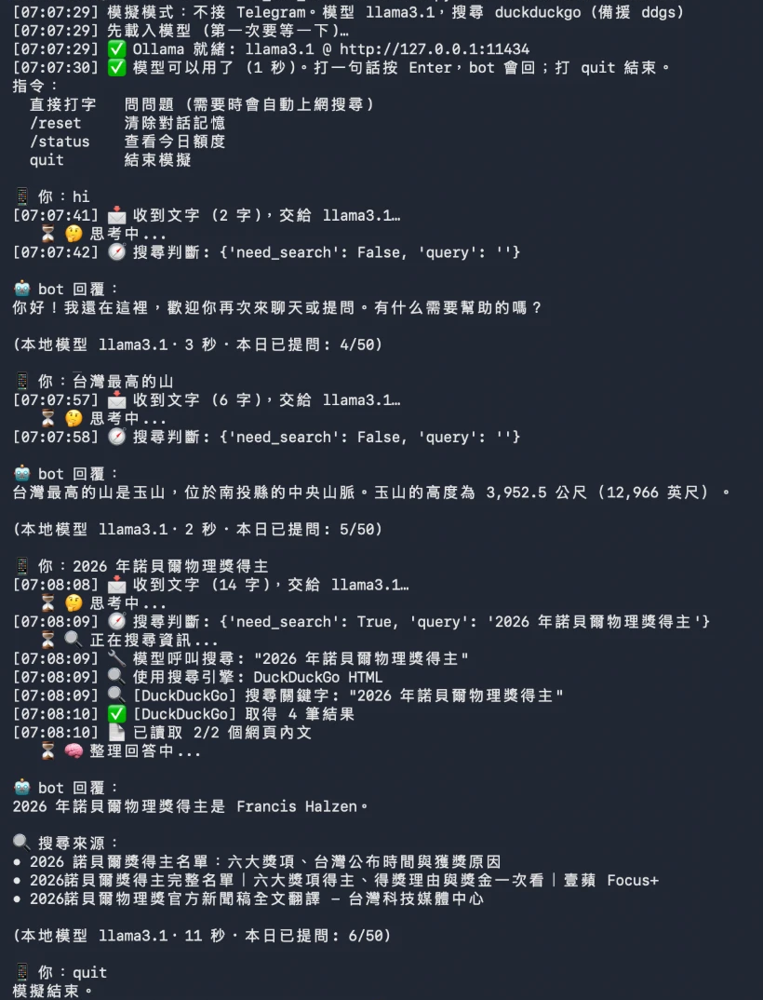
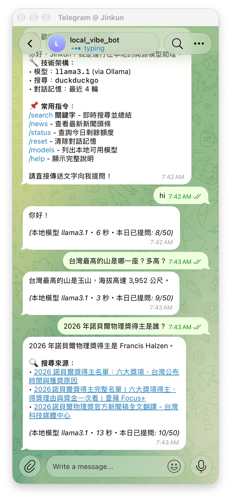

# 🤖 本地 AI Telegram Bot

完全在本地運行的 Telegram Bot，使用 **Ollama** 運行開源模型，支援 **Function Calling (工具呼叫)** 自動搜尋網路資訊。

## 📝 W6 回家作業說明 (Telegram 版)

> 老師的範例是 LINE bot (`line_bot_lite.py`)；本專案用 **Telegram** 完成同樣的目標：bot 用跑在自己電腦上的模型回答問題，不需要雲端 AI 的金鑰。

### 怎麼裝
- macOS：`brew install --cask ollama`、`open -a Ollama`、`ollama pull llama3.1`
- Python 用 [uv](https://docs.astral.sh/uv/) 管理：`uv sync`
- 關卡 B 才需要：Telegram Bot Token (找 @BotFather)、自己的 Telegram User ID (找 @userinfobot)

### 怎麼跑
- **關卡 A 模擬** (不接 Telegram、不需要 Token)：
  ```bash
  uv run python -m bot.main --simulate
  ```
  在 `📱 你：` 後面打字，bot 用本機模型回答；`/reset` 清除記憶、`quit` 結束。
- **關卡 B 真的接 Telegram**：
  ```bash
  uv run python -m bot.main
  ```
  `.env` 沒填 Token 時，啟動會詢問 (貼上時畫面不顯示，也不會存檔)。Telegram 用 long polling 主動拉訊息，**不需要 cloudflared 通道或 Webhook**。
- 自動測試：`uv run pytest`、`uv run python test/e2e_bot.py` (真實模型 + 搜尋的端對端測試)

### 我改了什麼：老師的做法 vs 我的做法

老師的 `line_bot_lite.py` 是「**一支檔案、不用裝套件、只有 CPU 也跑得動**」的最小版本；我的版本是「**模組化、會自己判斷要不要上網查、會讀網頁、有自動測試**」的延伸版，代價是程式比較大、要裝套件、需要比較好的電腦。

#### 1. 整體架構
| 項目 | 老師的做法 | 我的做法 |
|---|---|---|
| 程式 | 1 支 `line_bot_lite.py`，約 300 行 | 14 個模組，約 2,500 行 (`bot/`、`llm/`、`search/`、`config/`) |
| 依賴 | 只用 Python 內建功能 (`urllib`、`http.server`)，不用 `pip install` | 5 個套件 (python-telegram-bot、httpx、python-dotenv、beautifulsoup4、ddgs)，用 uv 管理 |
| 設定 | 環境變數 `MODEL`、`PORT` | `.env`，約 20 項可調 (模型、上下文長度、搜尋引擎、額度…) |
| 並行方式 | threading：每則訊息開一條執行緒 | asyncio：`async` / `await` |

#### 2. 訊息怎麼進來
| 項目 | 老師的做法 | 我的做法 |
|---|---|---|
| 平台 | LINE Messaging API | Telegram Bot API |
| 接收方式 | **Webhook**：LINE 主動把訊息送來，所以要用 cloudflared 開通道，讓外面連得到這台電腦 | **Long polling**：Bot 主動向 Telegram 拉訊息，**不用開通道、不需要公開網址** |
| 確認是真的平台送來的 | 用 Channel secret 檢查簽章，擋掉假冒的請求 | polling 是 Bot 自己連出去，不會收到外部請求，所以不用簽章；改用白名單 (`ALLOWED_USER_IDS`) 限制誰能用 |
| 啟動與結束 | 自動開通道、把 Webhook 換到本機；按 Ctrl+C 時換回原本網址 | 啟動時刪除舊的 Webhook，改用 polling |
| 金鑰 | 啟動時詢問 (不顯示、不存檔) | 可放 `.env` (已排除在版控外)；沒填就啟動時詢問 (不顯示、不存檔) |

#### 3. 模型與回答
| 項目 | 老師的做法 | 我的做法 |
|---|---|---|
| 模型 | gemma4:e2b (4.6 GB，CPU 也跑得動)；更小的備援 gemma3:1b | llama3.1 (8B，4.9 GB)，在 Apple M5 內建 GPU 上跑 |
| 上下文長度 | 4096 | 8192 (要放得下搜尋結果與網頁內文) |
| 回答格式 | 純文字、120 字內、先講結論 | Markdown 轉成 Telegram 格式 (粗體、清單、程式碼區塊)；超過 4096 字自動分段 |
| 打招呼 | 用規則判斷「hi、你好」，直接回使用說明，不叫模型 (秒回) | 交給模型回答 |
| 對話記憶 | 沒有，每題獨立 | 記住最近 4 輪，可以追問 (例如「那明天呢？」)；`/reset` 清除 |
| 一次處理幾題 | 加鎖，一次只答一題 (CPU 同時跑多題只會更慢) | 多位使用者可同時處理 (GPU 夠快) |

#### 4. 上網查
| 項目 | 老師的做法 | 我的做法 |
|---|---|---|
| 預設 | 不上網；加 `--search` 才查 (選做) | 每題都先判斷要不要查 |
| 搜尋服務 | Ollama 的線上搜尋 (要登入 Ollama 帳號) | 程式直接查 DuckDuckGo；被擋時暫停 10 分鐘，改用 ddgs 多引擎 (Brave、Google、Mojeek、Yahoo…)；不用帳號或金鑰 |
| 誰決定要不要查 | 模型自己呼叫搜尋工具 (最多 3 輪) | 先讓模型輸出 JSON 判斷「要不要查、查什麼」，再由程式去查；也保留原本的工具呼叫方式 (`SEARCH_DECISION=tools`) |
| 為什麼不一樣 | — | 實測 llama3.1 只要給它工具，**每題都會去查** (連「你好」也查)；改成先判斷後，14 題測試全部判斷正確 (DECISIONS.md ADR-014) |
| 給模型看的資料 | 每筆搜尋結果的前 1200 字 | 打開前 2 筆網頁，依問題關鍵字挑出相關段落 (每頁 2000 字內)，例如老師個人頁上的「開設課程」 |
| 來源 | 附網址 | 附可點的標題連結 |

#### 5. 等待、錯誤與紀錄
| 項目 | 老師的做法 | 我的做法 |
|---|---|---|
| 等待提示 | LINE「輸入中」動畫 (最多 60 秒) | Telegram「正在輸入…」+ 進度訊息 (思考中 → 搜尋中 → 整理中) |
| 回覆尾巴 | 模型名、秒數；沒上網時提醒「請自己核對」 | 模型名、秒數、今日額度、搜尋來源 |
| 出錯時 | 回「⚠️ 出錯了：錯誤訊息」 | 依錯誤種類回友善說明 (例如模型逾時、Ollama 沒開)，失敗不扣額度 |
| 防止濫用 | 沒有 (加了 bot 好友的人都能問) | 白名單 + 每日額度 |
| 紀錄 | 終端機只印字數，**不印問題內容** (投影時不會曝光) | `logs/bot.log` 系統日誌 + `data/logs/` 互動紀錄；終端機會印出搜尋關鍵字 |

#### 6. 模擬模式 (關卡 A)
| 項目 | 老師的做法 | 我的做法 |
|---|---|---|
| 做法 | 把終端機輸入包成 LINE 事件，走同一個 `handle()` | 把終端機輸入包成 Telegram 事件，走同一個 `_process_query()` |
| 能做的事 | 問答 (加 `--search` 可上網) | 問答、自動上網查、讀網頁；會顯示程式實際收到的文字；每次啟動清空記憶 |

#### 7. 測試
| 老師的做法 | 我的做法 |
|---|---|
| 照指南手動問三題 | `uv run pytest` 共 58 個測試 (多數不用網路與模型)；`test/e2e_bot.py` 用真實模型與搜尋跑 11 題，自動檢查「該查才查」、Telegram 格式是否正確、答案是否包含預期內容 |

#### 老師做法比較好的地方 (我沒有做到的)
- **一支檔案、不用裝套件**：最容易讀懂，也最容易交作業
- **舊電腦也能跑**：小模型加上一次只答一題，只有 CPU 也能用
- **打招呼秒回**：不用叫模型
- **不在終端機印問題內容**：投影或截圖時不會曝光；我的版本會印出搜尋關鍵字與模擬模式收到的文字
- **模型留在記憶體 30 分鐘** (`keep_alive`)：我的版本用 Ollama 預設的 5 分鐘，閒置之後的第一題會多等模型載入

### 跑起來怎樣
- **模型**：llama3.1 (8B，4.9 GB)
- **電腦**：Apple M5、16 GB 記憶體；沒有獨立顯示卡，Ollama 使用 M5 內建 GPU (`ollama ps` 顯示 100% GPU)
- **一題約幾秒** (模擬模式實測)：打招呼 3 秒、常識題 2 秒、需要上網查的約 10 秒；要讀網頁並整理長清單的題目約 20–40 秒
- **卡在哪 / 怎麼解決**：
  1. llama3.1 只要給它工具，每題都會去搜尋 (連「你好」也搜) → 改成先讓模型判斷要不要搜
  2. DuckDuckGo 短時間查太多次會回機器人驗證頁 → 偵測後暫停 10 分鐘，改用 ddgs 多引擎
  3. 只看搜尋摘要時答案不完整 (例如老師開的課只列出一門) → 讀取網頁內文
  4. 8B 小模型心算不穩 (123 × 456 偶爾算錯) → **尚未解決** (KNOWN_ISSUES.md ISSUE-020)

### 執行畫面
用老師指南的三題測試：打招呼、常識題 (台灣最高的山)、最近的事 (2026 年諾貝爾物理獎)。

**關卡 A：模擬模式** (`uv run python -m bot.main --simulate`)

前兩題判斷不需搜尋，直接由本機模型回答 (3 秒、2 秒)；第三題判斷需要搜尋，查 DuckDuckGo、讀 2 個網頁後回答並附來源 (11 秒)。



**關卡 B：真的接 Telegram** (`uv run python -m bot.main`)

同樣三題在手機上的回覆；頂端的「typing」是處理中的「正在輸入…」狀態，每則回覆尾巴有模型名稱與秒數。



> 搜尋題的答案來自網頁內容，模型不會自行查證；8B 小模型也可能答錯，請自行核對。

## ✨ 特色

- 🏠 **100% 本地運行** - 無需雲端 API Key，資料不出本機
- 🦙 **Ollama 整合** - 一行指令啟動模型，支援 llama3.1/3.2、Nemotron 3 Ultra、Command-R 等
- 🔧 **Function Calling** - 模型自主決定何時搜尋、搜什麼關鍵字、如何整理回答
- 🔍 **雙搜尋引擎** - DuckDuckGo HTML (通用) / Google News RSS (新聞)
- 🛡️ **白名單 + 配額** - 防止濫用，每日請求上限可調
- 💾 **本地持久化** - 對話歷史、配額、日誌皆存 JSON 檔案
- ⚡ **漸進式回覆** - 思考中 → 搜尋中 → 整理中 → 完成
- 📦 **uv 專案管理** - 極速依賴解析、Python 版本自動管理、單一鎖定檔
- 🧪 **完整測試套件** - 內建搜尋、Markdown、Ollama、對話、設定等單元測試
- 🐛 **完善除錯日誌** - 內建 DEBUG 等級日誌追蹤 handler 註冊、polling、訊息處理流程

## 🚀 快速開始

### 1. 安裝 Ollama 並拉取模型

```bash
# 安裝 Ollama (macOS 建議用 Homebrew 安裝桌面版，登入後自動常駐)
brew install --cask ollama
open -a Ollama

# 確認服務 (應回傳 Ollama is running)
curl http://127.0.0.1:11434

# Linux 可改用官方腳本：curl -fsSL https://ollama.com/install.sh | sh && ollama serve

# 拉取支援 Function Calling 的模型 (任選一)
ollama pull llama3.1        # 推薦：Meta 官方，支援工具呼叫
ollama pull llama3.2        # 較新版本
ollama pull nemotron3-ultra # NVIDIA，工具呼叫能力強
ollama pull command-r       # Cohere，專為 RAG 設計
ollama pull qwen2.5         # 阿里巴巴，中文強、體積小
```

### 2. 建立 Python 環境 (使用 uv)

```bash
cd wk06_bot_local

# 安裝 uv (若未安裝)
curl -LsSf https://astral.sh/uv/install.sh | sh

# 同步依賴 (自動建立 .venv、安裝套件、鎖定版本)
uv sync

# 或手動建立環境指定 Python 版本
uv venv --python 3.11
uv sync
```

### 3. 設定環境變數

```bash
# 複製範本
cp .env.example .env

# 編輯 .env 填入您的資訊
# 必填：TELEGRAM_BOT_TOKEN, ALLOWED_USER_IDS
# 選填：OLLAMA_MODEL, SEARCH_ENGINE 等
```

### 4. 取得 Telegram Bot Token 與 User ID

1. 找 `@BotFather` → `/newbot` → 取得 Token
2. 找 `@userinfobot` → 取得您的 User ID (數字)
3. 填入 `.env`：
   ```env
   TELEGRAM_BOT_TOKEN=123456789:ABCdefGhIJKlmNoPQRstuvwx
   ALLOWED_USER_IDS=123456789,987654321
   ```

### 5. 環境檢查與啟動

```bash
# 一鍵檢查環境 (Python、依賴、Ollama、模型、權限)
uv run python check_env.py

# 啟動 Bot
uv run python -m bot.main
```

看到 `✅ Bot 已啟動，開始輪詢訊息...` 即代表成功！

## 💬 使用指令

| 指令 | 說明 |
|------|------|
| `/start` | 歡迎訊息與功能介紹 |
| `/help` | 完整使用說明 |
| `/search <關鍵字>` | 主動搜尋並由 AI 總結 |
| `/news` | 瀏覽最新新聞頭條 |
| `/status` | 查看今日剩餘額度 |
| `/reset` | 清除對話記憶 |
| `/models` | 列出本地可用模型 |

## 🏗️ 專案架構

```
wk06_bot_local/
├── .env.example              # 環境變數範本
├── .env                      # 您的機密設定 (不納入版控)
├── pyproject.toml            # 專案設定、依賴、工具配置
├── uv.lock                   # 精確依賴鎖定檔 (納入版控)
├── requirements.txt          # pip 相容依賴清單
├── check_env.py              # 環境檢查腳本
├── README.md                 # 本文件
├── CHANGELOG.md              # 版本變更記錄
├── DECISIONS.md              # 架構決策記錄 (ADR)
├── KNOWN_ISSUES.md           # 已知問題與規避方案
├── WORKFLOW_GUIDE.md         # 開發流程、部署、測試策略
├── AGENTS.md                 # AI Agent 開發指南
├── config/
│   ├── __init__.py
│   └── settings.py           # 設定管理 (從 .env 讀取)
├── bot/
│   ├── __init__.py
│   ├── main.py               # 程式入口 (--simulate 為模擬模式)
│   ├── simulate.py           # 模擬模式：終端機打字，不接 Telegram
│   ├── handler.py            # Telegram 處理器 (指令、訊息、工具循環)
│   └── conversation.py       # 對話歷史、配額、授權、日誌
├── llm/
│   ├── __init__.py
│   └── ollama_client.py      # Ollama API 客戶端 (支援 Function Calling)
├── search/
│   ├── __init__.py           # 搜尋引擎工廠
│   ├── duckduckgo.py         # DuckDuckGo HTML 搜尋
│   └── google_news.py        # Google News RSS 搜尋
├── test/                     # 測試套件
│   ├── __init__.py
│   ├── run_all.py            # 統一測試執行器
│   ├── test_settings.py      # 設定測試
│   ├── test_search.py        # 搜尋測試
│   ├── test_markdown.py      # Markdown 解析測試
│   ├── test_ollama.py        # Ollama 測試
│   ├── test_conversation.py  # 對話/配額測試
│   ├── test_settings.py      # 設定測試
│   └── README.md             # 測試說明
├── data/                     # 執行時自動建立
│   ├── cache/history/        # 對話歷史 (JSON)
│   ├── quota/                # 配額記錄 (JSON)
│   └── logs/                 # 互動日誌 (JSONL)
└── logs/                     # 系統日誌
```

## 🔧 進階設定

### 切換模型
修改 `.env`：
```env
OLLAMA_MODEL=nemotron3-ultra
```
重啟 Bot 即可。需先 `ollama pull nemotron3-ultra`。

### 切換搜尋引擎
```env
# 通用網頁搜尋 (預設)
SEARCH_ENGINE=duckduckgo

# 新聞專用 (Google News RSS，穩定、繁體中文好)
SEARCH_ENGINE=google_news
```

### 搜尋來源與網頁內文
```env
# DuckDuckGo 無結果或被限流時，改用 ddgs 多引擎 (Bing/Brave/Google/Mojeek/Yahoo 自動切換)
SEARCH_FALLBACK_ENGINE=ddgs

# 搜尋後讀取前 2 筆網頁內文，讓模型能完整回答 (例如老師開的全部課程)
SEARCH_FETCH_PAGES=2
SEARCH_PAGE_CHARS=2000
```

### 搜尋判斷方式
```env
# 預設：模型先判斷是否需要搜尋 (寫程式、翻譯、常識等直接回答，新聞/天氣/股價才搜)
SEARCH_DECISION=router

# 原生 Function Calling：需模型本身能判斷 (llama3.1 會每題都搜，建議搭配 gemma4)
SEARCH_DECISION=tools
```

### 調整配額
```env
MAX_DAILY_REQUESTS=100
```

### 調整對話輪數
```env
MAX_HISTORY_TURNS=6
```

### 調整模型上下文長度
Ollama 預設上下文僅 2048~4096 tokens，system prompt + 對話歷史 + 搜尋結果容易被截斷：
```env
OLLAMA_NUM_CTX=8192
```

> 所有 `.env` 設定皆於啟動時讀取，修改後需重啟 Bot。

## 🛠️ 開發指南

### 常用 uv 指令
```bash
# 同步依賴
uv sync

# 新增套件
uv add httpx
uv add --dev pytest

# 移除套件
uv remove httpx

# 程式碼檢查
uv run ruff check .
uv run ruff check . --fix

# 執行測試
uv run pytest -v

# 執行腳本
uv run python check_env.py
uv run python -m bot.main
```

### 新增搜尋引擎
1. 在 `search/` 建立新模組 (如 `search/brave.py`)
2. 實作 `async def search_xxx(query, max_results)` 回傳 `List[Dict]`
3. 實作 `format_results(results)` 回傳格式化文字
4. 在 `search/__init__.py` 的 `SEARCH_ENGINES` 註冊

### 自訂工具
在 `llm/ollama_client.py` 的 `SEARCH_TOOL` 陣列新增工具定義，並在 `handler.py` 的工具循環中處理。

### 文件說明
| 文件 | 用途 |
|------|------|
| `CHANGELOG.md` | 版本變更記錄 |
| `DECISIONS.md` | 架構決策記錄 (ADR-001 ~ ADR-008) |
| `KNOWN_ISSUES.md` | 已知問題、優先級、規避方案、追蹤表 |
| `WORKFLOW_GUIDE.md` | 開發流程、Git 策略、測試、部署、除錯 |
| `AGENTS.md` | AI Agent 協作規範、模組職責、擴充指南 |

## 🐛 常見問題

### Q: 模型不支援 Function Calling 怎麼辦？
A: 請使用支援工具呼叫的模型：`llama3.1`、`llama3.2`、`nemotron3-ultra`、`command-r`、`command-r-plus`、`qwen2.5`。舊版 `llama3`、`mistral`、`gemma` (舊版) 等不支援。

### Q: 搜尋結果不準確？
A: 
- 嘗試切換 `SEARCH_ENGINE=google_news` (適合新聞)
- 確認模型正確提取關鍵字 (查看日誌 `🔧 模型呼叫搜尋: "..."`)
- 增加 `SEARCH_MAX_RESULTS`
- 使用能力更強的模型 (`llama3.1`、`nemotron3-ultra`)

### Q: 回覆很慢？
A: 
- 確認使用 GPU 加速：`OLLAMA_BASE_URL=http://127.0.0.1:11434` (預設會自動偵測 GPU)
- 使用較小模型：`llama3.2:3b`、`qwen2.5:3b`、`gemma2:2b`
- 調整 `OLLAMA_TIMEOUT`

### Q: 如何查看日誌？
```bash
# 系統日誌
tail -f logs/bot.log

# 互動日誌 (JSONL 格式)
cat data/logs/interactions_$(date +%F).jsonl | jq

# 配狀態
cat data/quota/quota.json | jq
```

### Q: qwen2.5 工具呼叫不穩定？
A: 這是已知問題 (ISSUE-001)。建議切換到 `llama3.1` 或 `nemotron3-ultra`：
```bash
ollama pull llama3.1
# .env: OLLAMA_MODEL=llama3.1
```

### Q: Telegram 出現 `Conflict: terminated by other getUpdates request` 錯誤？
A: 這是多實例衝突 (ISSUE-015)。解決方法：
```bash
# 1. 強制清理所有 bot 實例
pkill -f "bot.main" && pkill -f "uv run"

# 2. 清理 Telegram pending updates
uv run python -c "
import httpx, asyncio
from config.settings import settings
async def clear():
    url = f'https://api.telegram.org/bot{settings.TELEGRAM_BOT_TOKEN}/deleteWebhook'
    params = {'drop_pending_updates': True}
    async with httpx.AsyncClient() as client:
        await client.post(url, params=params)
    url2 = f'https://api.telegram.org/bot{settings.TELEGRAM_BOT_TOKEN}/getUpdates'
    async with httpx.AsyncClient() as client:
        await client.get(url2, params={'offset': -1})
asyncio.run(clear())
"
```

### Q: DuckDuckGo 搜尋回傳 0 結果？
A: 這是 ISSUE-016，已在 v1.0.2 修復。確保已更新 `search/duckduckgo.py`：
- 移除 `Accept-Encoding: br` (避免 Brotli 解壓失敗)
- 選擇器簡化為 `.result__body` (避免重複)

若日誌出現 `🚫 [DuckDuckGo] 被機器人驗證擋下 (HTTP 202)`，是短時間請求太多被限流 (ISSUE-002)。Bot 會自動冷卻 10 分鐘並改用 Google News (`SEARCH_FALLBACK_ENGINE`)，通常數分鐘到數小時後自動解除。

### Q: Google News 搜尋語法錯誤？
A: 這是 ISSUE-017，已在 v1.0.2 修復 `search/google_news.py` 的 `decode_xml_entities` 函數。

### Q: Markdown 粗體/斜體/程式碼顯示異常？
A: 這是 ISSUE-018，已在 v1.0.2 修復 `bot/handler.py` 的 `markdown_to_html` 函數。

### Q: `search_sync` 出現 `RuntimeError: This event loop is already running`？
A: 這是 ISSUE-019，已在 v1.0.2 修復 `search/__init__.py` 的 `search_sync` 函數，使用 `ThreadPoolExecutor` 隔離執行。